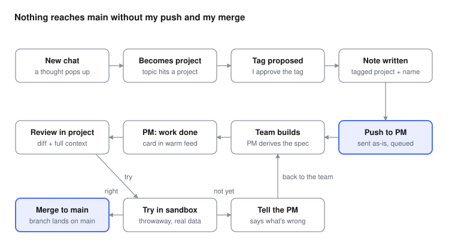

# Collaborator UX Redesign — Intentions

Sep 27, 2026 · revised Oct 6, 2026 after review against the code

## Framing

Collaborator is now a tool for shaping emergence: I design the conditions, and outcomes come out of them. It has moved through three identities:

1. **Chat app** — a conversation partner.
2. **Extended cognition** — a place to think with Collaborator.
3. **Fertile ground / shaping emergence** — things get created and placed, grouped by association rather than filed into many object types.

What it's turning into is a self-sovereign personal AI hub: one place for an individual's own AI, running on local inference over their own chats, notes, people, events and transcripts, where nothing leaves unless they send it. It's meant to be open source and runnable by anyone willing to set it up. Documentation and housekeeping should reflect this.

Building software with an agent team is one significant part of that, not the whole of it, and it isn't built or tested yet. Where it applies, it's intent-driven development, past spec-driven. A spec is a contract written once; an intent is something I hold and keep steering. The engineer drives the spec, deriving it from my intent, so my job stays at the intent layer. That doesn't mean I don't want to ever see specs, it's just the main space I occupy.

When building, three things a human still needs to know: is it working, is it doing what I meant, and what did it cost. Only the middle one needs me. But monitoring alone removes the creation element, so the app leads with creating and steering intentions, with health and cost kept ambient.

This is a user-experience overhaul, not a frontend one. It covers both repos: most of what's described here needs backend work to exist at all, and the backend is as much in scope as the screens. The document is here to say what changes and what stays the same; it isn't a feature inventory, and something that already works and isn't changing may not be mentioned.

## Tags, types and frontmatter

Tags are how things get organized, and they're the one mechanism the whole app shares. Chats wear them, and so does everything in the note graph: notes, events, people, and whatever types come later. Tags identify what an entry is associated with and where it surfaces; projects are one case of that, covered under Projects.

- Frontmatter is reconsidered, not removed. It carries a type's own fields (events have dates, contacts have details), not project membership, which tags already carry. The one test is real fields: a tag whose entries carry fields of their own earns frontmatter, and nothing else has any. Projects have no fields, so they have none.
- Type and frontmatter come together or not at all. A tag that earns a type earns frontmatter; nothing else has any. Event, social-graph (people) and user-profile qualify; those are the tag names as they exist in the code today. Goal, question, decision and memory don't: they never proved worth a separate view, so they become ordinary tags I can put on a note, with no type, no fields, no `state`, no page of their own and no lens in Mind. Their existing frontmatter is removed, not just hidden.
- The type tags stay mutually exclusive: a note is an event or a person or a profile note, never two of those. `project` leaves that exclusive set, since it carries no fields once `state` goes. That is what lets an event or a person belong to a project: today the backend rejects `project` beside `event`, and it must stop.
- Tag hygiene is prevention only, for now, and it's already built. Because projects are emergent, a typo silently forks one: half the notes wear the right name, half wear the near-miss, and the project view quietly shows less than exists. So tagging suggests existing tags as I type, and a new tag that's a near-miss of an existing one (a case or plural difference, or up to two characters off on a tag of five or more) asks whether I meant that instead. Most typos die there.
- Repair (renaming a tag everywhere, merging two into one, retiring one) is deliberately deferred. It isn't a problem yet, and building it before it is would be building for a mess I don't have.

## Destinations

The bottom bar holds five destinations, left to right: Feed, Chats, Scratch, Events, Projects. They must be reachable most of the time (call/voice mode is one exception), and that persistence is what the bar is for. Scratch sits in the center and looks different from the other four, because it's the one I reach for fastest.

- Mind stops being a place. The hamburger menu stays and ends up holding the archives I consult rarely and on purpose (Notes, People, Transcripts) alongside what's already there: Web Search, Settings and Sign out. References moves into settings, next to Profile, since it's about what the model is being shown rather than something I browse.
- An entry's type is derived from its tags. Some tags, like event, social-graph (people) or user-profile, mean "this one gets different frontmatter": they set its type, which decides its fields and what its own page looks like. Every other tag decides where it lives and what it's associated with. Tags like bug and feature don't set a type either; they're ordinary tags, and the project view doesn't filter by them.
- A destination is earned by how often I reach for it, nothing else. Events, Projects and Scratch are on the bar because I open them constantly, not because of their shape (Projects lands on a list, and that's fine). People are a directory I consult rather than land in, so it sits in the hamburger menu. Goals, questions, decisions and memories are plain tags with no type and no destination; they surface through chats, search and association.
- Notes, in the hamburger menu, goes straight to the whole pile: the list of notes and the graph itself, with a selector to sort by date or other means.
- Mind's lenses are accounted for individually rather than as a place. People goes to the hamburger menu, Notes and the graph with it, Projects and Events to the bottom bar, and the drafts inbox into the Feed. Profile moves into settings: it's mine, edited rarely, not browsed. Goals, decisions, questions and memories keep no lens at all.
- Nothing floats over every screen. A permanent capture bubble is clutter in an agent conversation or a review.
- **The inference switch is on every screen.** It lives in the top bar next to the hamburger menu, separate from the bottom bar. It toggles local inference between serving Collaborator only and serving all requests (a separate script proxies the port on the Mac). It's a pill-shaped switch with a round knob that slides to one end and the current state written inside it on the other side, so the setting reads at a glance rather than from knob position alone. The pill is red while set to Collaborator only. It's also the switch the Notifications section refers to, so stops caused by flipping it don't notify.

### Feed

Opening the app shows a single feed ordered by warmth, not a list of conversations. Warmth covers both what I was just doing and what moved while I was away.

- Warmth starts dumb on purpose: an item's warmth is the later of "I last touched it" and "it last changed", and shape weight only breaks ties. Nothing is scored. I'll prune and add rules once I've lived with it.
- The feed mixes recent chats, notes I touched, upcoming events, pending approvals, and from agent channels only open questions and messages the backend flags as needing me. Plain unread channel messages stay out.
- Tapping an item opens that object or navigates to the appropriate destination (possible second tap).
- A message the backend flags as needing me notifies once and sits in the feed; its notification clears when the endpoint closes the question. Everything else from agents arrives quietly as unread in the project.
- Branching conversations leave the front door. Branching stays as a chat-level feature, not an organizing concept.
- Agent handoff chatter does not go into the warm feed; it would bury what actually needs me.
- Pinning is necessary: some things stay at the top of the feed regardless of warmth.

### Chats

- A list of chats, pinned at the top and the rest by recency. Same behaviour as Scratch, so it's learned once.
- Each row shows the chat's title, its tags if it has any, and its last line, which is usually what I'd recognise it by. An untagged chat visibly lacks a tag, so it reads as loose rather than lost. This list is exhaustive, so an untagged chat is always findable here; a derived "no tag" filter, like Scratch's, rounds them up on purpose. The same holds for Notes in the hamburger menu.
- The floating new-chat button appears here and only here. But holding down on the "chat" destination button on the bottom bar should also spawn a new chat.
- Seeds and conversations are the same object. In the code a chat is a tree of turns, and the only difference between a seed and a conversation is a state flag on the root's subtree. The distinction survives, but promotion stops being something I do by hand: a chat is promoted the moment I do something deliberate to it (name it, tag it, branch it, or synthesize notes from it). The Chats tab lists everything, seeds included; the promoted ones also sit in a Conversations list inside the Chats area, reached from a control in the top bar next to the hamburger menu, meaning "chats I invested in". The state flag stays as a cache that those actions set.
- Chat tags are a new thing. Tags exist in the backend today only on individual turns, where they feed recall; nothing is tagged at the level of a chat. Chat tags live on the root turn: the root is stable across promotion and branching, and the whole tree hangs off it. Whether chat tags also feed recall is decided when they're built. Each chat in the list gets a three-dots control on its right. Tapping it opens a card about that chat: a short summary generated on demand by a small model, plus the chat's tags, viewable and editable there. Generating the summary also proposes tags; that is the only time chat tags are proposed, and otherwise they're set by hand. The same three dots sit in the top bar while I'm inside a chat and open the same card.

### Scratch

Scratch is Note to Self, like Signal: a chat-like screen where anything gets dumped, whether it's something to remember, a link sent to myself for later, or a YouTube link to transcribe. Mostly it's a transport, the cross-device inbox where things land to be picked up on another device or processed. It has its own shape, a stream, and things arrive in it on their own. It reads like a chat: newest at the bottom, nearest the composer, not at the top as it is today. It sits at the center of the bar and is visually distinct, for quick access.

- Scratch is for activity, not retrieval, and it holds two kinds of item. Events have a lifecycle and clear themselves: a YouTube link sent for transcription moves through sent, transcribing and transcribed, the notification fires at transcribed, and then it leaves Scratch. I don't wait on the screen, since a transcript takes minutes, and I often don't open it at all; I ask the LLM to find it so we can talk about it. Transmissions (links, photos, documents, text sent between devices) have no completion, and some need to stay forever.
- The list is transmissions minus completed events. I can pin as many as I want at the top; the rest sit below by recency.
- No manual categories. Filtering is derived from what each item already is (links, photos, documents, text, voice), so anything new arrives already sorted. The filter stays quiet, a control I reach for once the list has grown rather than a row of chips always on screen.
- Each item renders as what it is, the same principle as the feed's object shapes. A link shows the page title and favicon, not the URL. A photo shows the photo. A document shows its filename and type. A YouTube transcription in flight shows the video's title and thumbnail plus its state, so the stream reads as recognizable things instead of a column of identical links.
- Transcripts have their own screen, separate from Scratch, reached from the hamburger menu. It keeps its own shape (title, channel, length, date) rather than dissolving into the scratch pile. The transcript-ready notification opens it at the one that just finished. Channel isn't captured today — title, duration and date are — so it has to be added at transcription time, and it becomes something I can filter and search by. Transcripts also carry optional tags, so one tagged with a project's name shows up in that project.

### Events

The calendar. Today most events are created by Collaborator on my behalf, and I still keep Google Calendar because entering things there is easier. The bar for this destination is therefore not "works" but "I reach for it instead of Google."

What Google gets right is that the calendar is the form. You tap a slot on the week, drag to size the window, type a name, save. The date and duration are never typed. Today's Events view is an agenda and a month grid, both read-only: tapping opens the note, and the only way to make an event is through a chat or the notes editor. The gesture doesn't exist yet, and that is the whole gap.

Rules for the pass:

- Events opens on a **week time-grid**. Tap-and-drag on it creates an event note in place; the title is the only typed field. Start and end land in frontmatter as real fields. Agenda and month remain as the other views.
- I can enter events myself this way, and Collaborator can enter them for me from a chat, as it does now. Same note either way.
- Collaborator does not sync with Google or link an account. It swallows an **ICS** when one arrives: an ICS shared into Scratch or a chat becomes a proposed event I accept, the same way chat-drafted notes are proposed. Export to ICS already exists and stays.
- **Recurrence** is a rule in the event's frontmatter, not a second object. Occurrences are always derived, never stored: the expander takes the rule and today's date and does arithmetic, with no model involved. This is what lets the warm feed find "next Monday's" instance mechanically. Settled over separate notes per occurrence: one file is the truth, the horizon is infinite, "all of them" is one edit, and ICS import and export map straight onto RRULE and EXDATE. This reverses the v1 rule in NOTES-FORMAT.md, which gets updated with it.
- Per-occurrence changes (one cancelled Monday, one moved to 8) are an **exceptions list** in the same frontmatter. Still one file. Exceptions are kept forever, never pruned: a cancelled Monday pruned after the fact would reappear in that week as having happened, and the calendar has to stay truthful looking back.
- An occurrence that needs a body of its own (notes from one meeting, different people) becomes an ordinary event note for that date, linked to the series, and an exception points the occurrence at it. That is the only way an occurrence gets its own content; the rule note never grows per-occurrence fields.
- Editing a note that has a rule asks "this one or all of them", the way Google does; editing a one-off never asks. "This one" writes an exception; "all of them" rewrites the rule. The rule, the exceptions and the "this one" choice all have to be expressible through the model's typed note tools too, since frontmatter is never written by the model directly.
- Expansion lives in the existing `list_events` path, which both the calendar views and the model's `list_events` tool already use. The model sees the same expanded occurrences I do. It can still open the note and read the rule in `fields`, which is the truth, but it never has to compute a calendar itself.

What beats Google is not the gesture, which only reaches parity. It's that an event is a note: it can carry a body, link to people and a project, and it lives in markdown I can take anywhere.

### Projects

A project is a window into something in motion. Not every project is software. A project is whatever a name tag gathers, and every project opens on the same plain view, agents or not. That is the whole of a project like the economics game or a piece of writing, and it has to stand on its own. Everything tagged with the project name belongs here.

#### The project view

One vertical page, no sideways scrolling, top to bottom (2026-10-20, replacing the shelves and the conversation-first landing):

1. **Agents row.** Shown only when a backend serves the project. It just says "Agents", with a badge when something is waiting on me (a flagged message or an open question). No dots, no status. Tapping it opens the agent area: the conversation, the channel tabs and everything else under When a project has agents.
2. **Chats and conversations**, most recent first.
3. **Notes**, most recent first. Each row shows the note's name and its last-edited date. Events, people and docs tagged with the project are notes and sit here like any other.
4. **Transcripts**, most recent first, at the bottom because I use them least.

Each section shows its five most recent items and a "show all" link.

- No horizontal carousels for notes or chats.
- No tag chips (feature, bug, decision, issue). A project holds too little for them to filter anything useful, and search is already in the header.

#### How a project forms

A project exists once a note is tagged `project` plus one other tag, taken as its name. Anything wearing `project` and that name joins it, chats included. That's the whole membership rule, and it's how it works today.

- `project` marks a note or chat as belonging to a project.
- The name tag says which project. The rule is single membership: a note belongs to exactly one project. So among the tags on project notes, the name is the one that never appears beside another name, while `bug` turns up beside many different names. The exclusivity check in the code is just how that rule is detected, not a way of discovering projects; the `project` tag already declares that. If an unrelated tag happens to behave like a name, the fix is an override in the app (pin this tag as a name, or ignore it), never retagging the notes, and the overrides sit in a small visible list in settings so they're not hidden state.
- Tags like `bug` and `feature` are ordinary tags: they don't place anything inside the project view. A bug tagged with another project's name never appears in this project's view.
- The manual state field goes, here and everywhere else it appears. It was set by hand, so it went unused, and it stopped making sense once a project became a collection of notes: a comment, an idea, a feature and a spec share no universal status. Where a status survives, it is derived from something happening to the note and belongs to that happening, not to the note. The software case is one example: a sent note has a lifecycle (sent, building, ready for review, merged) that the agent backend reports as events. Other kinds of project will have their own, or none.
- There is no repo field on a project note, and no repository in note frontmatter. In the case of a software project, pi-session-manager already knows which repo belongs to a project name, so storing it here would duplicate a fact that lives elsewhere, and duplicated facts drift. Collaborator's own `git_read` and `git_issue` tools (reading code, filing an issue when I ask) take the repo they're given; they aren't part of the agent seam, and nothing about a repo is carried on a note.

#### When a project has agents

Everything below is the agent area, reached from the Agents row at the top of the project view. It exists only when the project's tag exactly matches a project tag that an agent endpoint serves. No project type is set by hand; the match is the switch. The contract itself lives in the companion doc, *Collaborator Agent UX and Backend Seam* (2026-10-19), which wins wherever the two disagree; this section records what it means for the rest of Collaborator. pi-session-manager is one backend among possible others, and a single coding-agent session has to fit the same shape.

#### Channels and the conversation

Chats are me thinking with Collaborator (extended cognition); agent channels are me delegating. They look different.

- A backend exposes channels. Each declares a label, whether it accepts input, whether it has a firehose, a one-line status, and whether it's busy. Collaborator shows the label as it arrives and never names a role: no "PM", "engineer" or "auditor" anywhere in the UI, and no generic name for the default channel either.
- The default channel is the one that accepts input, and its conversation is where opening the agent area lands, with the channel strip and tabs around it. If several accept input, I choose the default and Collaborator remembers it. If none does, the project is watch-only.
- Channels that don't accept input are read-only: a status line and a firehose to watch. Talking to one of them directly (the old engineer Q&A) is out for now. With pi-session-manager only the PM's channel accepts input; that is the backend's policy, expressed through its flags, not a Collaborator rule.
- When the other side is mid-turn, the input shows that my message is queued, so I never resend.
- Channel conversations live in their own table, never in Chats: the messages in input-accepting channels, questions and their answers, kept for catch-up and history. The firehose is never stored beyond a short in-memory live buffer; the backend owns that record.
- The conversation moves over from Telegram once this UX is settled.

#### Sending a note

A note is mine until I send it.

- A note has a send button only when its project has a channel that accepts input. Nothing goes out until I press it.
- The note arrives in the conversation as part of my message, carrying a snapshot and a stable note ID. Sending it again is a new message with the same ID, which the backend treats as an update to the same note and versions on its side (for pi-session-manager, commits over the same file). Whether a sent note becomes part of the project's permanent record is the backend's choice. I can also just talk about the note in the conversation.
- Collaborator's model can stage a send from any chat through a tool call. A staged send is a draft, the way note drafts are, and goes out only when I approve it in the project or note view. That approval, and where the send button sits, belong to the deferred project-view work.
- Collaborator never writes to a repository for agent work: no commits, no bot token, no `@pm` subject lines. The backend's managers do their own git operations, and only the one that identifies as the director can direct the team. Collaborator's own `git_read` and `git_issue` tools stay; they aren't part of the agent seam.

#### Status, questions and attention

What I see is either conversation or glanceable state, never a scroll of notifications.

- Milestones arrive as events: handoffs, work complete, audit verdicts, and where each thing I sent stands (intentions in flight). An event updates its channel's status line and drops a marker into its firehose. Events are status: never chat, never notifications.
- A message can carry a question: a prompt, zero or more options, single or multiple choice, and whether free text is allowed. My answer is an ordinary message referencing it. When the endpoint closes a question, Collaborator shows the outcome in place of live controls. Merging is one of these: the endpoint asks, and I press a button. The exact question shape waits on a walk-through of what pi's ask_human passes through today.
- Only what the backend flags as needing me notifies, once, with no repeated reminders, and the notification clears when the endpoint closes the question. Idle or stalled work is the backend's to notice: it flags its own message and Collaborator routes it. Collaborator doesn't detect idleness itself.
- Health is one quiet badge per project when any endpoint serving it is degraded or unreachable; tapping it lists which, with cause and since-when, and it clears on recovery. Collaborator marks a silent endpoint unreachable itself. An unreachable endpoint is the badge only, never a notification. When the team is paused because I flipped the inference switch, the badge says so instead of showing it as degraded.
- Cost (time, tokens) is out of scope for now.

#### Firehose, replay and links

- A firehose is a zoomable raw stream: thinking, tool calls, file edits, test runs. It follows the live end while I watch, stops when I scroll up, offers a jump back to live, and never fights the reader.
- Replay is built on the pi-session-manager side. pi's RPC instance keeps its session through a lost connection, so the manager can resend a channel's history; the contract gets a history request ("send this channel from sequence number X"). Collaborator still stores nothing beyond its live buffer.
- Channel links (a message pointing at a moment in another channel's firehose) wait for replay; until then there is nowhere for a link to land.
- Reading agents against their reference (a firehose beside the intent or spec its work came from) is deferred until replay exists. Specs remain a backend concept; Collaborator doesn't model them.
- The branch timeline is dropped for now; git history stays with the backend. Restart controls are deferred; for now I ask in the conversation.

#### What crosses the seam

- The vault never reaches agents. Nothing from Collaborator's store crosses toward a backend unless I send it by hand, as a message or a sent note, and backends never read from Collaborator.
- Agent output is untrusted. Channel content stays out of recall and out of the model's tools, the way Scratch does, while unified search still finds it for me. One explicit tool lets the model read it, used only when I ask ("what did the PM say about X"), and its results are marked as agent output.
- A firehose moment I pin becomes a note in the vault, marked with where it came from. That is the only way agent output enters the vault, and only by my hand.
- Each endpoint is paired once to the user who approves it, from a short fingerprint shown on first connect. Endpoints reach Collaborator over the tailnet only, never through the public reverse proxy.
- A backend tag with no matching Collaborator project shows in the Projects list, and opening it creates the project and its name note. A Collaborator project with no backend tag simply has no channels. Tags match exactly; a renamed tag breaks the match until it's fixed by hand.

#### Trying the work

The slow part of building isn't the model writing code; it's finding out whether a change was actually good. The backend runs the branch and sends Collaborator a preview link on the tailnet, as an event or a message carrying a URL, and I tap it to open. Collaborator's box doesn't pull, run or render anything: previews belong to the backend.

**Collaborator as its own project (open).** The earlier design below predates backend-run previews and is kept until it's settled whether it still holds (see Open questions). Collaborator is the one project whose testing build has to run against my real, current state, because an empty account doesn't show what a change feels like in daily use, and real data is too precious to risk.

- It ran against a **session copy** of my data, not an overlay: the SQLite file, the vault and the media directory copied into a session directory, the testing build pointed at the copies through the existing config paths, its own index rebuilt. The copy is deleted when the session ends and swept at the next start if a crash left one behind. The testing branch migrating its own copy makes schema drift a non-problem.
- It ran where the data is, never on the agents' side: code goes to the data, data never goes to the agents.
- Side effects were a policy on the tool dispatch under a sandbox flag, not a property of the copy. Allow: web search, video transcription, local inference and voice. Real but bounded: Lightning payments, from a small sandbox wallet (see Money). Block: sending to agent channels, Gitea writes, the inference switch and notifications. Every stubbed or blocked result says so in its text, so the model in the sandbox doesn't act on fake success.
- A test drive, not a migration path: no save, no diff, no cherry-picking back into real data. Built for small changes I'd notice in use; it doesn't replace automated tests. A clear indicator shows I'm in a sandbox for the whole session.

#### The delegation flow: chat to merge

A loose thought becomes project work without me filing anything, but two gates stay mine: sending a note, and merging.

The diagram predates the 2026-10-20 seam decisions: read "Push to PM" as sending a note, and "Merge to main" as answering the endpoint's merge question.

**Chat to intention.** I open a new chat, and the conversation drifts into an existing project (say, the Minecraft player agent). Collaborator can notice the drift and say so in the conversation, but it doesn't reach for the tags at that point. Tags on the chat get proposed when its summary is generated from the card, or I set them myself. The substance becomes a note tagged `project` plus the project name, so it appears in that project.

**Sending.** I send the note from the note view, or approve a send Collaborator's model staged. It arrives in the project's conversation as part of my message, and from there the backend decides how it reaches the team.

**Trying and merging.** When the work is done, the endpoint says so in the conversation, with a preview link when there's something to try, and asks whether to merge. I open the link and use the change the way I normally would. If it's right, I answer merge. If it isn't, I say what's wrong in the conversation, the work goes back to the team, and the next completion asks again. After merging, I mostly want to go see what was built.

## Search

Search is fragmented today: there's no search in Chats, Scratch has its own bar, Mind has another for the note graph, and web search sits behind the hamburger menu. Four bars meaning four different things.

- One search over my own world. It reaches chats, notes, Scratch, transcripts and agent conversations at once, because I usually don't know which pile something landed in.
- This search is mine, not the model's. Scratch stays unreachable to the conversation agent, as it is today: it lives in its own table, nothing logs its content, and the model sees an item only when I hold-send it. Unified search includes Scratch for me and never feeds it into the model's search tools. Whoever builds the index has to keep that line.
- A search bar inside a screen isn't a separate feature. It's the same search, scoped to what I'm looking at. these search bars should appear anywhere a user would intuitively expect.
- Web search is a different job and stays as it is for now. The LLM in chats already searches the web by tool call, and for an ordinary web search outside it I'd just open Brave, so a Brave-backed bar isn't worth rebuilding.
- The model's own search tools sort into two. Web search against the Brave API is the working one and stays. The lethe\_search tool goes: Lethe was a prototype indexer, and it's replaced by a DITTA search tool that queries my broker and gets whatever it federates to.
- The DITTA tool talks to the broker's client door, which works differently from the Lethe proxy. The paid credential binds to the exact bytes of one request, so it's one payment per query and there is no reusable token to store. There's a quote endpoint, so the price is known before anything is paid. The 402 carries a challenge signed by the broker's own key, so the tool can check who it's paying; the expected pubkey is pinned in config. If no indexer answers, the broker says the credential is retained and the same bytes replay free.
- The whole payment loop lives inside the tool: quote, check the per-query cap, pay from the wallet, replay the request, return results. One call. The model never sees an invoice, and the caps in config are the only control. Result text is untrusted display content, handled the way web search results already are.
- The broker's address is configuration, never code: a URL that may be a domain, an IP or an onion address. An onion needs a SOCKS proxy, which is an optional config setting; the tool works the same whether the box reaches the broker directly, over a VPN, or through Tor.
- What's worth having later is searching through DITTA myself, without the LLM in between. It comes in as a clearly labelled DITTA search once there are indexers and brokers worth querying; having it close at hand will help bootstrap the protocol.

## Money

Collaborator has a Lightning wallet of its own, and the shape copies what the broker already does: one LNbits wallet on my LND node, funded with a working budget, with two keys scoped to that wallet alone. The invoice key can create invoices and read their status and cannot move money. The admin key can pay invoices from that wallet and nothing else, so the blast radius of a leaked key is the wallet's balance, not the node. Collaborator holds no node-level credential.

- **Pay.** The LNbits pay provider is a near-verbatim copy of the broker's: park-before-pay ledger, per-payment and per-day caps on top of the wallet's balance, amountless invoices refused, preimage polling, and a lookup by payment hash so a timed-out payment is recovered rather than repeated. The L402 minting that paid search needs is provider-agnostic and only wants the preimage back.
- **Receive.** Collaborator can mint invoices with the invoice key. The first use is asking me for more money: when its balance runs low it presents an invoice to top itself up, and I pay it from my own wallet. More uses will come.
- **Per user.** The wallet is keyed by user identity, as the NWC connections map is today, so a multi-user deployment gives each user their own wallet.
- **NWC stays as a dormant provider.** It's proven working live and costs nothing to keep behind a provider switch, but LNbits is what runs. Several hundred lines of relay and encryption code leave the live path.
- **The sandbox gets its own wallet.** A second LNbits wallet with a small balance, named in the sandbox build's config. Payments in the sandbox are real but bounded, which is better than stubbing them.

## Voice

Voice is how I use Collaborator most, and it's already good. Two changes.

- Attachments mid-conversation. I should be able to hand over a photo, a link or some text without dropping out of voice. Right now needing to show it something means leaving the conversation, and that's the real gap.
- Reasoning that's actually readable. It shows while thinking and stays through the response and the speech, but it isn't genuinely expandable: the expansion is a few lines at a time. It should be full height and scroll as it streams, because the wait while it thinks is exactly when I have attention to spare and it isn't talking yet. It doesn't need to persist once the mic reopens; scrolling back is enough.

## Attachments

Attaching things mid-conversation is the one item here that isn't really a UX decision. The storage layer already exists: Scratch accepts images, audio, video and files, stores them content-addressed on disk, and serves them back through its media endpoint, and the chat composer has an attach button sitting there marked coming soon. What doesn't exist is the rest: getting a file into a chat or a call rather than only into Scratch, extracting anything from it, and indexing what comes out. The interface is the small part; that pipeline has to be built first. It deserves to be sequenced as its own piece of work, but it belongs to this overhaul.

- Ingest should be as inclusive as possible rather than a fixed list. Images, PDFs, DocX and Markdown are the obvious examples, but the world is full of file types, and if there's an existing library that handles the long tail it's worth pulling in rather than enumerating formats by hand.
- Extraction is per kind: text out of documents, OCR off scans and screenshots, and image recognition for photos. The local model already handles vision natively, OCR included, so none of this needs a second model standing beside it or a separate OCR engine wired in.
- Whatever comes out has to be stored with the attachment and indexed, so attachments fall inside the one search over my own world rather than being a blind spot in it.
- Built (2026-10-15): every attachment is stored on the server, so every device sees it. Its text is extracted once and kept with it: markitdown for documents, PDF text layers with scanned pages read by the chat model, images read by the chat model, and speech-to-text for audio and video. On the turn it's sent, an image goes to the model as an image; after that, and for every other kind, the model reads it as text. The full text is always one read_attachment away. There is one vision model, the chat model; Settings → Model has a test that proves images get through. The old second vision model for screenshots was removed (2026-10-19) once qwen proved itself on images.
- The voice feature waits on this. Handing over a photo or a link without leaving the conversation is the payoff, but it can't be built until the pipeline underneath exists.

## Notifications

- An agent notifies me only through a message its backend flags as needing me (a question, work ready to review, work that has stalled), and it arrives as the heavy card with an action. It notifies once, never as repeated reminders, and clears when the endpoint closes the question. Noticing idle or stalled work is the backend's job, not Collaborator's.
- Infrastructure trouble never notifies. A degraded or unreachable endpoint is a quiet health badge on the project, nothing more.
- Stops I caused show as mine. If I flip the switch in Collaborator that stops LM Studio or the MacBook script listening for the agents, the health badge says the team is paused by me rather than degraded. Collaborator knows because it flipped the switch; the agents will hit an error either way.
- A YouTube transcript being ready notifies me.
- None of this exists yet, at either end. There is no notification system in the app today and no delivery behind it, so this section is built from nothing rather than adjusted: the backend work is as much a part of it as the screens.
- Notifications live in the settings menu as a list, so I can add new kinds later and make them optional.
- Every item on the list is optional, with no special cases. Agent stops and YouTube transcripts are on by default.

## Object shapes and visual weight

The feed is a simple list of differently shaped objects; shape, not labels, tells me what each thing is. The more an item wants from me, the more visual weight it gets, so warmth sets the order and shape sets the urgency.

| Object | Shape | Weight |
| --- | --- | --- |
| Recent chat | Single line of text | Light |
| Note | Compact line or snippet | Light |
| Agent message flagged for me | Card from an actor | Medium |
| Agent question / pending approval | Card with an action on it | Heavy — it is blocking on me |
| Project | Denser block with several things inside | Medium |

Tapping any object takes me into that world. Exact visuals are still open.

**Shape is a hard constraint; arrangement is not.** An object draws the same way wherever it appears, so I never learn two visual languages for the same thing. That one goes in the spec and is something I'd send work back over. How things are arranged is local and left to whoever builds the screen: the feed orders by warmth, search orders by relevance, and whether results group by kind is a judgement call in context.

**Empty states are a rule, not a design.** Every screen with nothing in it says what belongs there and how to put the first thing in, rather than just being blank. I will almost never see these, but I do plan to open source this eventually, and for a first-run user the empty state is the onboarding. The wording isn't mine to write; I'd rather meet it in the sandbox than specify it.

## Core flows

These are the everyday flows: what using Collaborator is like most of the time, in projects or out of them. Each one says what it promises, walks through how it goes, and names the decisions it rests on. Where a flow runs into something unsettled, it points at the open question rather than answering it. The software delegation flow lives under Projects, since it only exists where a project has an agent team.

### Hand-off between devices

**The promise:** something I find on one device is waiting on the other, without my filing it anywhere.

I'm on my phone and come across a link I want to look at properly later, at the Mac. I tap Scratch, the centre of the bottom bar, and drop it in. It lands at the top of the list and renders as what it is: the page's title and favicon, fetched when it arrives, not a bare URL. Photos arrive as the photo, documents as a filename and type, text as text.

Later, at the Mac, I open Scratch and it's there, drawn the same way. I open the page, or bring it into a chat and ask about it. Most transmissions simply sink down the list by recency; nothing needs clearing. If it's something I'll keep coming back to, I pin it and it stays on top. I never sort anything into categories: if the list gets long, I filter by what the items already are (links, photos, documents, text, voice), and the filter stays quiet until I reach for it.

- Rests on: Scratch is a destination and a transport, not a capture tool. There are no manual categories, and pinning is the only way to keep something up.
- Still open: how the Scratch screen is laid out and what it looks like at rest; whether arrivals from another device belong in the feed.

### Watch later, find later

**The promise:** a long video becomes something I can ask about, without watching it or waiting for it.

I drop a YouTube link into Scratch and long-press send. Unlike a plain link, this starts something: it shows as an event in flight, with the video's title, thumbnail and current state. Over the next five to ten minutes it moves from sent to transcribing to transcribed. I'm not watching; I've gone back to whatever I was doing.

When it reaches transcribed, a notification fires, and the item leaves Scratch by itself: completed events clear themselves, so Scratch only ever shows what's still in motion or still worth keeping. The transcript now lives in Transcripts, behind the hamburger menu, drawn with its own shape: title, channel, length and date.

Often I never open it. Days later, in any chat, I ask what that talk said about something, and the model finds it by content or title. The URL is an implementation detail I never say out loud. This doesn't work today: the model can only reach a transcript by re-running transcription on the same URL, so asking for the one about the trade deal fumbles unless I hand it the link. I hit this constantly, so it's real work, not a nice-to-have. Transcripts is there for the times I want to browse or read one in full.

- Rests on: Scratch items come in two species, events with a lifecycle and transmissions without one. Scratch is activity and Transcripts is retrieval. There is one search over my own world, and transcripts are found in it by content or title, never addressed by URL.
- Still open: whether finished transcripts show in the feed. A transcript belongs to a project the way anything does, by wearing its tag.

### Thinking out loud

**The promise:** talking instead of typing costs me nothing I could do with my hands.

I'm in a voice conversation, working something through while walking or driving. Partway in, I want the model to see something: a screenshot, a photo of a label, a PDF, a link. I hand it over without leaving voice. The conversation carries on, and the model responds to what I gave it, including any text in it, since the local model reads images natively.

While it thinks, its reasoning is shown at full height and scrolls as it streams, so I can actually read it rather than catching a few lines at a time. It stays up through the response and the spoken reply, and clears when the mic reopens. When the call ends, the conversation is an ordinary chat in Chats, with the attachment in it, and it can be tagged like any other.

- Rests on: voice changes only in these two ways. Attachments are their own piece of work, and voice waits on them. What's extracted from an attachment is stored and indexed, so it's never a search blind spot.

### A thought becomes a note

**The promise:** the part of a chat worth keeping ends up where it belongs, without my leaving the chat to file it.

A chat turns up something that should outlive it: a date, something about a person, a decision and why I made it. Collaborator notices and drafts it as a note on its own; this already happens today. I'm the gate: a proposed note isn't kept until I accept it. Today proposals land in an inbox; they should surface in the Feed instead, alongside everything else waiting on me. Its tags decide the rest. Tagged as an event, it becomes one, with an event's fields and its own page, and it shows up in Events. Tagged with a project's name, it joins that project. Tagged with neither, it's still a note, reachable by search.

Collaborator already proposes tags, and should somehow be made aware of what tags already exist and what type the yare so it can assign accurately, and I accept or change them. As I tag, existing tags are suggested, and a new tag that's a near-miss of an existing one asks whether I meant that one, so projects don't quietly split in two. The chat itself can wear tags too; one that doesn't visibly lacks them, so it reads as loose rather than lost.

- Rests on: tags are the one organising mechanism, and a note's type comes from its tags. Tag hygiene is prevention, not repair.

### Coming back

**The promise:** after time away, one screen shows me what's warm, and anything else is one tap away.

I open the app after a day or two and land on the Feed. It mixes whatever is warm: recent chats, notes I touched, agent messages flagged for me, anything waiting for my approval, and upcoming events, with pinned items first. Agent handoff chatter and plain unreads never appear here. Each item keeps its shape, so a chat reads light, a flagged agent message medium and an agent's question heavy; I can tell what needs me before reading a word.

Tapping an item opens it or takes me to its destination. For anything the feed doesn't show, the bottom bar is one tap away, and search reaches all of my own world: chats, notes, Scratch, transcripts and agent conversations.

- Rests on: the warm feed is home, pinning is needed, and shape carries meaning while arrangement doesn't.
- Still open: exactly what belongs in the feed.

## Open questions

- [x] How is a project laid out on mobile? Settled 2026-10-20: one vertical page for every project. An Agents row (only with a backend, a badge when something waits on me) opens the agent area; then chats, notes and transcripts, each the five most recent with "show all". No carousels, no tag chips. Where staged sends are approved is still open.
- [x] Does anything get pinned in the warm feed, or is it purely ordered by warmth?
- [ ] What does each object shape actually look like?
- [x] Where does merge land me? Revised 2026-10-20: merge is a question the endpoint asks, with buttons, after I've tried the preview link; afterwards I go see what was built.
- [x] Tag proposals: Collaborator proposes tags every time it drafts a note, as it already does. For chats, tags are proposed only when a chat's summary is generated from the three-dots card; otherwise chat tagging is manual. Collaborator may still remark in conversation that a chat is drifting into a project; it just doesn't apply or propose tags mechanically at that moment.
- [x] Transcripts carry optional tags, like everything else. A transcript tagged with a project's name belongs to that project on that basis alone; there is no separate notion of a transcript being a project object.
- [x] Two ways into the work: sent notes and messages in the conversation. Revised 2026-10-20: both are messages over the seam; a sent note carries a snapshot and a stable ID, and how each is kept is the backend's choice.
- [x] Reference pane marking the current paragraph: dropped. The whole reading-against-reference view is deferred until replay exists (2026-10-20).
- [ ] The flow diagram predates the 2026-10-20 seam decisions (push, sandbox, merge-in-review).
- [x] Restart control: deferred (2026-10-20); for now I ask in the conversation. The earlier shape was two controls (restart, pull-and-restart), both hold-to-confirm, no in-flight readout.
- [x] Untagged chats and notes: not homeless. Chats and Notes are exhaustive lists, so nothing is reachable only by remembering it; Feed shows what's warm and search finds the rest. Chats and Notes get a derived "no tag" filter, like Scratch's, so loose things can be rounded up.
- [x] Bottom bar, or another way to keep the destinations always one tap away?
- [x] Floating button or a composer strip above the bar for Scratch?
- [x] Per-type note pages, settled for the two types that have them. **Event:** date first, then the recurrence rule and any exceptions where they exist, then the body, with its links to people and a project. **Person:** their fields and the note's own body lead; what references them (notes, chats, events) sits underneath as links. The People list itself is alphabetical with letter separators (A, B, C…), nothing more for now. Goal, question and decision pages are off the table; those are plain tags.
- [x] Scratch layout: it looks like a chat, and it already nearly does. The one change is direction: today newest is at the top, and it should be newest at the bottom, the way a chat reads, with the composer under it. Transient events just disappear when they complete. Derived filters remain. Where pinned items sit in a chat-shaped list is left to implementation.
- [x] What do mixed-type search results look like? Shape is fixed globally; grouping and ordering are the implementer's call.
- [ ] Recall of chat turns from a note. Notes come from turns, but the model can't get back to the turns a note came from. Parked; not tangled with Events.
- [x] Collaborator sandbox side effects beyond the data store: a policy on the tool dispatch under a sandbox flag. Allow the harmless, give payments a bounded sandbox wallet, block sends to agent channels, Gitea writes, the inference switch and notifications. The sorted list lives in the Trying the work section and grows with the tools. Whether any of this survives backend-run previews is open (2026-10-20).
- [x] Collaborator sandbox schema drift: gone with the overlay. The sandbox runs on a session copy of the data, so the testing branch migrates its own copy.
- [x] Overlay or copy: copy. One SQLite file, the vault and the media directory into a session directory, deleted when the session ends, swept at startup if a crash left one behind.
- [x] What belongs in the warm feed? Recent chats, notes I touched or that changed in the app, upcoming events (warming within a day of starting), pending approvals, finished transcripts, and merged work (shown once the agent layer produces it). From agent channels, only open questions and messages the backend flags as needing me (2026-10-20). Scratch arrivals stay out: Scratch is its own stream. A note's "changed" is the app's record of an edit, never file times. (2026-10-13)
- [x] How does a note get made from a chat: do I ask for it, is there a control, or does Collaborator offer?
- [x] Seeds vs conversations: same object, one state flag. Promotion is derived from a deliberate act (naming, tagging, branching, synthesizing), not pressed by hand. Conversations is the list of promoted chats inside the Chats area, reached from a top-bar control beside the hamburger.
- [x] Chat tags: on the root turn. Tags exist today only per turn, for recall; chat-level tags are new.
- [x] Recurring events: one note with a rule and an exceptions list, exceptions kept forever; an occurrence that needs its own body becomes a linked one-off note.
- [x] Where a sent note lands: superseded 2026-10-20. Collaborator never commits; the note goes over the seam and the backend commits it. The bot token, the `@pm` commit and the push gate are gone.
- [x] Wallet: LNbits on my LND node, pay and receive, copied from the broker; NWC kept dormant; sandbox gets its own wallet. Built 2026-10-14 as `wallet.py`: one `wallet` tool (balance, pay, top-up invoice) in place of `nwc_pay`, with `tools.wallet.provider` choosing lnbits or nwc. The two can sit on different nodes, so each keeps its own daily cap, and an attempt parked by one is never checked or repaid through the other.
- [ ] Which box Collaborator runs on once it needs Tor or a VPN to reach the broker. The DITTA tool doesn't care, but the move is real work.
- [x] DITTA search tool, built 2026-10-14 as `ditta_search` (ditta.py), replacing `lethe_search`: quote, per-query cap, signed-challenge check against the pinned broker pubkey, payment through the wallet, byte-identical replay. A retained credential is parked so the same ask replays free; an unconfirmed payment is resumed through the wallet rather than re-asked. Onion brokers need `tools.ditta.proxy`.
- [x] Whether chat tags feed recall the way turn tags do. Not yet (2026-10-12): chat tags organize only. They're stored apart from turn tags, so recall can scope by them later (most likely by project, once project views exist) without a data migration.
- [x] Projects base view, built 2026-10-13 (its shelves and kind-tag chips are replaced by the 2026-10-20 project view; the rest stands): Projects is on the bar (Feed, Chats, Scratch, Calendar, Projects); a project's notes and chats sit on shelves filtered by kind tags; name overrides (hold a project: not a name; hold a kind tag: treat as a name) are listed in Settings. Mind is gone: Notes (with the graph and Profile) and People are in the menu, the drafts inbox is reached from the Feed. Events in projects stay possible but get nothing bespoke (no events shelf). Transcripts carry tags since 2026-10-14, edited on the transcript's own page with the same completion and near-miss check as chats, and a tagged one sits on its project's Transcripts shelf; the model's `list_transcripts` filters by tag too. References and Profile moved into Settings (2026-10-14), as rows at the top of the sheet that open their own pages; Notes now opens straight on the whole pile, with no lens picker.
- [x] What is a doc? Just a note, distinguished by a tag that identifies it (`spec`, for instance) or simply by looking at it. No separate object, type or shelf: in a project, the kind-tag chips filter to it. (2026-10-14) Revised 2026-10-20: the chips are gone, so a doc is simply one of the project's notes.
- [ ] Note editing experience: to be overhauled over time. I have ideas for it; on the back burner for now. (2026-10-14)
- [x] "No tag" filters on Chats and Notes, built 2026-10-17: one quiet filter icon in each header opens the derived filters (just "No tag" for now); the active one shows as a chip with a count under the header until cleared. Untagged notes are marked "untagged" in their rows, like chats.
- [x] Scratch stream, built 2026-10-17: newest at the bottom by the composer, "Load older" at the top. Pins sit in a strip above the stream (as many as I like, most recently pinned first), collapsible, remembered per device. The quiet filter (links, photos and videos, documents, text, voice) is derived from each item's kind and narrows pins too. A transcription item shows its job's live state (transcribing, failed) and leaves Scratch once the transcript is done, unless it's pinned; a failed one stays.
- [x] Scratch items render as what they are, built 2026-10-18: a link shows its page title, site and favicon; a YouTube link its thumbnail, title and channel; a document its filename, type and size; a video plays in place. Previews are fetched once per URL in the background by the server (never a model), through fetch_url's exit and guards (with a webtool configured, no icons or thumbnails, since those would go out direct), and the images are served by the app so the phone never contacts the linked site. `scratch.link_previews: false` turns it off.
- [x] Inference switch, built 2026-10-18. The gate it drives lives in `gate/`, self-contained (its own deps, tests, launchd install and docs) so it can be pulled onto the Mac alone; Collaborator's side is `backend/gate_client.py` + `/api/gate` + the top-bar pill. Labels "Collab only" (red, knob right) and "All requests" (knob left), state written opposite the knob; the knob shows how many agent requests are held. Hidden when no gate is configured, "Gate offline" when it can't be reached; chat never waits on it. Flips are recorded (`gate_client.flipped_within`) so the agent-stops notification, once it has a producer, can stay quiet about stops I caused.
- [x] Unified search, built 2026-10-18 (`backend/unified_search.py`, `GET /api/find`): one search over chats, notes, Scratch, transcripts and attachments, grouped by pile with "show all", from a search button in the top bar on every screen. Chats got a search bar (the same search, scoped to chats); the Notes, Scratch and Transcripts bars keep filtering their own lists and offer "Search everywhere for …". A hit opens where it lives (a chat at its matching turn, Scratch with the query in its bar, an attachment in its sheet). It includes Scratch, so it is never a model tool; a test checks no tool can reach Scratch through it. Keyword only for now; agent conversations join when they exist.
- [x] Attachments mid-call, built 2026-10-18: a paperclip on the call screen hands over a photo or file (uploaded at once, as a chat attachment) or text or a link (pasted, prefilled from the clipboard when allowed) without leaving voice. What's handed over waits in a strip ("Goes with what you say next", each removable) and goes with the next spoken turn: files as attachments (an image reaches the model as an image), text and links appended to the words, so a link is fetched as in a typed message. The turn in the call transcript shows what went with it. Files lined up in the composer come along when a call starts (hold send, 2026-10-19): with the draft when there is one, else they go to the model as they are, with no words added, and the call opens on the reply. The strip's "Send now" does the same mid-call: whatever is handed over goes without waiting for me to speak.
- [x] Readable reasoning in calls, built 2026-10-19: the thinking streams into the conversation itself, inside the reply it leads to, at reading size (not the old few-line strip in the header). While it thinks it has the whole conversation area and the view follows it; scrolling up to reread stops the follow, and scrolling back down near the end resumes it. Once the reply starts, the view follows the spoken paragraph as before and the thinking (now labelled "Thought") stays above it. Never spoken, never saved; it's gone when the mic reopens. Typed chats show it the same way (2026-10-19): inline in the reply at full height, followed while it streams, then the reply is followed until its first line would leave the screen; it stays under the finished reply until the next send. The rule for every follow-scroll, calls and chats alike: it never fights the reader. Nothing moves while a finger is on the list or just after a flick, a scroll up by hand stops the follow until I come back to the end or tap "Jump to latest", and a new turn starts it afresh.
- [ ] Scratch files and chats: for when Scratch itself is the focus. Scratch media and chat attachments are separate stores on purpose: the chat model's `list_attachments` / `read_attachment` reach every chat attachment and nothing in Scratch. Hold-send reads a Scratch file (same reader as attachments), keeps that text on the Scratch item only, and runs the one-shot action, which has no chat to answer into. So bringing a Scratch file into a conversation today means attaching it again from the composer. Open: should a Scratch item get a deliberate "Send to chat" that copies the file into the attachment store, as the one sanctioned way across the line, or is re-attaching the right amount of friction? (2026-10-17)
- [x] The Events destination is called **Calendar** (the `event` tag keeps its name). Built 2026-10-13: week grid (tap a slot for an hour, drag or hold-and-drag to size, only the title typed), agenda and month, "this one or all of them" from a tapped occurrence, .ics import as proposals. Conversations folded into Chats (a control in its header) so the bar is Feed, Chats, Scratch, Calendar, Mind until Mind's contents move to the menu and Projects takes its place.
- [x] How notifications reach the phone: a self-hosted ntfy server (on the web server, not the Collaborator box), dormant until configured; every notification is also stored in the app. Transcripts notify when a background job finishes or fails; short in-turn ones don't, since I'm already looking at the reply. (2026-10-13)
- [x] Agent layer, settled 2026-10-20 against the companion doc *Collaborator Agent UX and Backend Seam*, which wins where the two disagree: channels with labels and flags, no role names in the UI, sent notes instead of pushes, events for status, questions for merges, previews as backend-sent tailnet links, channel content out of recall and model tools, one explicit agent-output tool, endpoints paired per user over the tailnet. Branch timeline dropped; engineer Q&A, restart controls, reading against a spec and cost are out or deferred.
- [ ] Collaborator as its own project: with previews run by the backend, does Collaborator's testing build still run next to my data on a session copy, with the sandbox dispatch policy? (2026-10-20)
