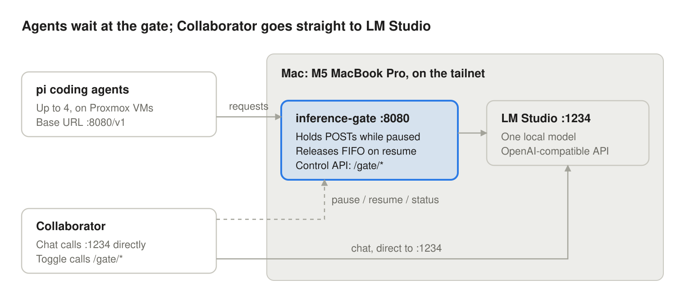

# Inference Gate — Build Spec

Sep 28, 2026 ·&#32;

## Purpose

Build `inference-gate`: a small reverse proxy on the Mac that lets the pi coding agents share LM Studio, but holds their requests whenever Collaborator is in use.

The Mac (M5 MacBook Pro, 128 GB) runs one model in LM Studio. Up to four pi agents on the Proxmox VMs, across two projects, will use it around the clock. Collaborator is interactive and must never wait behind them. The agents are background work and can always wait.

The gate does one thing: when paused, it stops forwarding new agent requests and holds them open until resumed. Collaborator bypasses the gate entirely by calling LM Studio directly, so the gate never has to identify or prioritize it.

The builder must also write the control API documentation that Collaborator's engineers will use to add the pause/resume toggle later (see Documentation deliverables).

The gate ships inside Collaborator's repo, in a `gate/` folder, since Collaborator is its only controller. It runs as its own process on the Mac; it is not part of the Collaborator app.

## Architecture



The agents point at the gate on port 8080; Collaborator keeps using LM Studio on 1234 and only talks to the gate to pause, resume or read status. The gate must be reachable over the tailnet, since the VMs and Collaborator's host are not on the Mac.

## Required behavior

The gate holds one boolean, `paused`, and forwards everything else untouched. Suggested stack: Python 3.11+ with asyncio (aiohttp or FastAPI + httpx), single file, no database.

**Proxying**

- Forward every path under `/v1/*` to the upstream (default `http://127.0.0.1:1234`) with method, headers, query and body unchanged, minus hop-by-hop headers.
- Stream responses through as they arrive, including SSE (`stream: true`). Never buffer a full response.
- Only `POST` requests are gated. `GET` requests such as `/v1/models` always pass straight through, so agents can start up while paused.
- No upstream read timeout. A long generation must not be cut off by the gate.

**Pausing**

- `paused` defaults to `false` on startup and is kept in memory only. A gate restart resumes the agents.
- Pausing affects only requests that have not been forwarded yet. Requests already streaming from LM Studio finish normally; nothing is cancelled mid-generation.
- While paused, a new gated request is held: the handler awaits a resume event and keeps the client connection open. It sends nothing to the client until it is released.
- If a held client disconnects, drop its request and never forward it.

**Resuming**

- On resume, release held requests in arrival order (FIFO).
- Optional setting `max_concurrent_upstream` (default unlimited) caps how many requests are in flight to LM Studio at once. When set, released requests queue behind it in the same FIFO order.
- Expected load is small: at most 4 held requests, usually 2. No queue size limit is needed, but log a warning above 8.

**State the gate tracks**

| Field | Meaning |
| --- | --- |
| `paused` | Whether new agent requests are being held |
| `paused_since` | ISO 8601 timestamp of the last pause, or null |
| `queued` | Requests currently held by the gate |
| `in_flight` | Requests forwarded and not yet finished |
| `total_forwarded` | Counter since startup, for sanity checks |

## Control API

Three endpoints under `/gate/`, on the same port as the proxy, form the whole contract Collaborator's toggle will use. Treat this as a stable, versioned interface.

| Method | Path | Effect | Returns |
| --- | --- | --- | --- |
| `GET` | `/gate/status` | None | Status object |
| `POST` | `/gate/pause` | Sets `paused = true` | Status object |
| `POST` | `/gate/resume` | Sets `paused = false`, releases held requests FIFO | Status object |

Status object:

```json
{
  "api_version": 1,
  "paused": true,
  "paused_since": "2026-09-28T19:42:10Z",
  "queued": 2,
  "in_flight": 1,
  "total_forwarded": 318
}
```

Rules:

- Pause and resume are idempotent. Pausing twice is fine; `paused_since` keeps the first timestamp.
- Every `/gate/*` call requires `Authorization: Bearer <GATE_TOKEN>`. Missing or wrong token returns `401` and changes nothing.
- Responses are `application/json` and return within 100 ms; they never wait on LM Studio.
- `/gate/*` requests are never gated or forwarded upstream.
- Log every state change with its timestamp and the caller's IP.

Example:

```bash
curl -X POST -H "Authorization: Bearer $GATE_TOKEN" http://<mac-tailnet-name>:8080/gate/pause
```

## Deployment

The gate runs on the Mac as a launchd user agent, next to LM Studio, and restarts on crash or reboot.

Configuration comes from environment variables, with these defaults:

| Variable | Default | Notes |
| --- | --- | --- |
| `GATE_HOST` | `0.0.0.0` | Tailnet reachability is required |
| `GATE_PORT` | `8080` | What the pi agents point at |
| `UPSTREAM_URL` | `http://127.0.0.1:1234` | LM Studio's OpenAI-compatible server |
| `GATE_TOKEN` | none, required | Refuse to start without it |
| `MAX_CONCURRENT_UPSTREAM` | unset (unlimited) | Optional cap |
| `LOG_LEVEL` | `INFO` |  |

Ship in the gate/ folder:

- `local.inference-gate.plist` for `~/Library/LaunchAgents/`, with `RunAtLoad` and `KeepAlive` set, logging to `~/Library/Logs/inference-gate.log`.
- An `install.sh` that creates a venv, installs dependencies, writes the plist and loads it with `launchctl`.
- A `.env.example` listing every variable above. The real token lives in a gitignored `.env`.

Log one line per request (arrival, held, released, finished, client disconnected) with a short request id, so a stuck agent can be traced.

## Pi agent changes

On each of the four VMs, switch pi from the commercial provider config to the local one, and point the local one at the gate instead of LM Studio.

1. Comment out the commercial (OpenRouter) provider entry and uncomment the local provider entry.
2. Set the local provider's base URL to `http://<mac-tailnet-name>:8080/v1`, not port 1234.
3. Set the model id to exactly what LM Studio's `/v1/models` reports for the loaded model.
4. Remove or raise any client request timeout, so a request held for an hour is still waiting when released.
5. Lower the context window to about 32k to start; raise it only if agents lose the thread.

The builder should document these steps in the README with the real file paths and field names from pi's config, verified on one VM before the other three.

## Acceptance tests

The gate is done when all of these pass, automated where possible with a fake upstream that streams slowly.

- [ ] Unpaused, a streaming chat completion through port 8080 matches one sent directly to 1234.
- [ ] Paused, a new `POST` is held with no bytes returned; `/gate/status` shows `queued: 1`.
- [ ] Paused, `GET /v1/models` still returns immediately.
- [ ] Pausing during a stream lets that stream finish; `in_flight` drops to 0 afterwards.
- [ ] Three requests held while paused are forwarded in arrival order on resume.
- [ ] A held request whose client disconnects is never forwarded upstream.
- [ ] A request held for 30 minutes completes normally after resume.
- [ ] `/gate/pause` without the token returns 401 and does not pause.
- [ ] Pause and resume called twice in a row behave the same as once.
- [ ] After `launchctl kickstart -k` or a reboot, the gate is back up and unpaused.
- [ ] Live check: one pi agent on a VM completes a real task through the gate, including a pause and resume mid-task.

## Documentation deliverables

Collaborator's engineers will build the toggle without reading the gate's code, so `docs/CONTROL_API.md` must stand on its own. All three live in the gate/ folder of Collaborator's repo; paths below are relative to it.

| File | Audience | Must contain |
| --- | --- | --- |
| `README.md` | Future maintainers | What the gate does, install, config table, pi config steps, how to read the logs |
| `docs/CONTROL_API.md` | Collaborator engineers | The integration contract below |
| `CHANGELOG.md` | Both | Any change to the control API, with its `api_version` |

`docs/CONTROL_API.md` must cover:

- **Endpoints**: each method, path, request, response and error code, with a `curl` example and a sample JSON response.
- **Semantics**: pause holds only new agent requests; one agent request already in flight may still finish, so Collaborator's first reply after pausing can wait on it.
- **Where Collaborator fits**: Collaborator keeps calling LM Studio on port 1234 directly and only calls the gate to toggle and read status.
- **Auth**: the bearer token, where it is configured on the Mac, and that it should be stored in Collaborator's settings, not hard-coded.
- **Recommended UI**: a pause/resume switch, plus a small indicator driven by `queued` and `in_flight`, polling `/gate/status` every 2–5 seconds.
- **Failure handling**: if the gate is unreachable, show the switch as "gate offline" and let chat continue; a gate failure must never block Collaborator.
- **Versioning**: check `api_version` and warn on an unknown value.
- **Reference client**: a 20–30 line TypeScript or Python snippet with `getStatus()`, `pause()` and `resume()`.

## Out of scope and open questions

Out of scope for this build: cancelling or preempting in-flight generations, per-agent priorities, the Collaborator toggle itself, and auto-pausing based on Collaborator activity.

Open questions:

- Can the VMs reach port 1234 directly? If so, an agent could bypass the gate. Consider a Tailscale ACL that allows 1234 only from Collaborator's host.
- Should pause auto-expire (for example after 60 minutes idle) so agents aren't stranded if user forgets to resume?
- Should `paused` survive a gate restart instead of defaulting to unpaused?
- Does LM Studio serve parallel requests well on this model, or should `MAX_CONCURRENT_UPSTREAM` default to 1 or 2?
